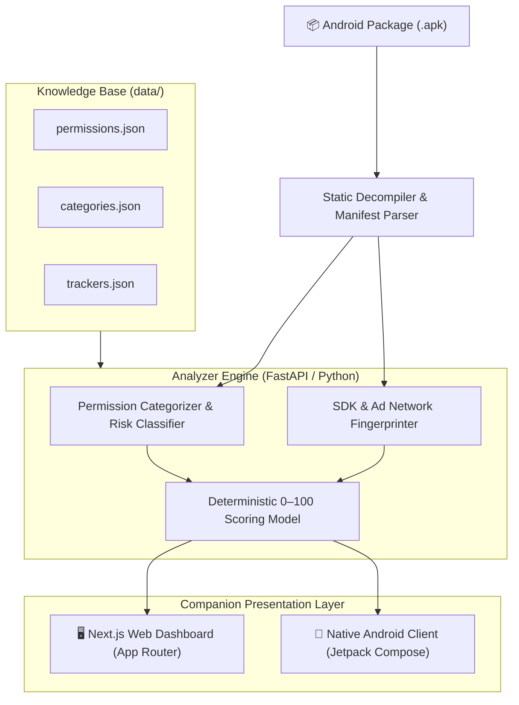

<div align="center">

# 🛡️ Android Privacy Auditor

### Understand What an Android App Asks For — And Why.

*A local-first static analysis platform and companion dashboard for Android APK privacy scoring, permission classification, and tracker fingerprinting.*

[](https://github.com/Scempyyy/privacy-auditor/releases/tag/v1.0.0)
[](https://github.com/Scempyyy/privacy-auditor)
[](https://nextjs.org)
[](https://fastapi.tiangolo.com)
[](https://www.typescriptlang.org)
[](https://developer.android.com/jetpack/compose)

[⬇️ Download Client APK (v1.0.0)](https://github.com/Scempyyy/privacy-auditor/releases/tag/v1.0.0) · [Explore Architecture](docs/ARCHITECTURE.md) · [Scoring Model](docs/SCORING.md)

</div>

---

## 📖 Overview

**Android Privacy Auditor** examines Android application packages (`.apk` files) without running or installing untrusted bytecode. It decompiles package manifests, identifies declared and unusual runtime permissions, detects embedded third-party ad/tracking SDK signatures, checks security-hygiene flags, and computes a transparent, explainable **0–100 privacy score**.

> 💡 **Notice:** A privacy risk score is an analytical signal to empower user decisions—not proof that an application is malicious or safe.

---

## ⚡ Key Capabilities

- 🔍 **Static Manifest Ingestion**: Extracts package metadata, requested Android permissions, declared activities, receivers, and service exports without bytecode execution.
- 🏷️ **Category-Aware Permission Classification**: Evaluates permissions against expected baselines for the app's category (e.g. Camera in Photography vs Camera in a Flashlight app).
- 🕵️ **Tracker & Ad SDK Detection**: Scans compiled DEX classes against an indexed database of behavioral tracking, advertising, profiling, and analytics libraries.
- 📐 **Deterministic 0–100 Scoring**: Transparent mathematical scoring heuristic where every single deduction is itemized with an explicit justification. Zero black-box LLM hallucinations in the scoring loop.
- 🛠️ **Remediation Guides**: Step-by-step actionable instructions guiding non-technical users on how to revoke unnecessary or dangerous permissions in Android system settings.
- 🔒 **100% Offline & Private**: Runs entirely on `localhost`. Zero cloud telemetry, no analytics beacons, and no external data exfiltration.

---

## 🏗️ System Architecture



---

## 📁 Project Structure

```text
android-privacy-auditor/
├── analyzer/                    # FastAPI backend static analysis service
│   ├── app/                     # API routes, analyzers, manifest decoders
│   ├── tests/                   # Pytest automated test suite (31 tests)
│   └── requirements.txt         # Pinned Python dependencies
├── web/                         # Next.js companion report dashboard
│   ├── app/                     # File-based App Router pages & layout
│   ├── components/              # Score dials, tracker cards, permission trees
│   └── package.json             # Frontend dependencies (TypeScript, Tailwind)
├── data/                        # Version-controlled security knowledge base
│   ├── permissions.json         # Android permissions catalog & risk levels
│   ├── categories.json          # Category baselines & permission expectations
│   ├── trackers.json            # Tracker signatures & profiling categories
│   └── revoke_steps.json        # Step-by-step revocation guides
├── docs/                        # Specifications and design documentation
│   ├── SPEC.md                  # Functional MVP specification
│   ├── SCORING.md               # Deterministic scoring mathematical model
│   └── ARCHITECTURE.md          # Architecture, data flow & security boundaries
└── README.md                    # Project documentation
```

---

## 🚀 Getting Started

### Prerequisites
- **Python**: `3.10+`
- **Node.js**: `20.x` or `22.x`
- **Git**: `2.40+`

---

### 1. Analyzer Service (`analyzer/`)

```bash
# Navigate to analyzer directory
cd analyzer

# Create and activate virtual environment
python3 -m venv .venv
source .venv/bin/activate

# Install dependencies
pip install -r requirements.txt

# Run automated tests (31 tests)
PYTHONPATH=. pytest -v

# Start FastAPI development server
uvicorn app.main:app --host 127.0.0.1 --port 8000 --reload
```

The REST API will be accessible at: `http://127.0.0.1:8000` (Swagger docs at `/docs`).

---

### 2. Companion Web Interface (`web/`)

```bash
# Navigate to web directory
cd web

# Install dependencies
npm install

# Build production bundle
npm run build

# Start local Next.js server
npm run dev
```

Open `http://localhost:3000` in your browser.

---

## 📦 Client Release APK

A pre-built Android companion APK is attached to GitHub Releases:

- **Filename:** `app-release1.apk`
- **Size:** `10.40 MB`
- **Download:** [Download Android Privacy Auditor v1.0.0 Release](https://github.com/Scempyyy/privacy-auditor/releases/tag/v1.0.0)

---

## 🛡️ Privacy & Safety Guarantees

1. **Static Analysis Only**: Uploaded APKs are never executed or installed on the host machine.
2. **Zero Cloud Telemetry**: Next.js telemetry is permanently disabled, and the backend makes zero external outbound connections.
3. **Deterministic Output**: Scoring deductions are mathematical and reproducible across runs.

---

## 📄 License

This project is licensed under the [MIT License](LICENSE).
